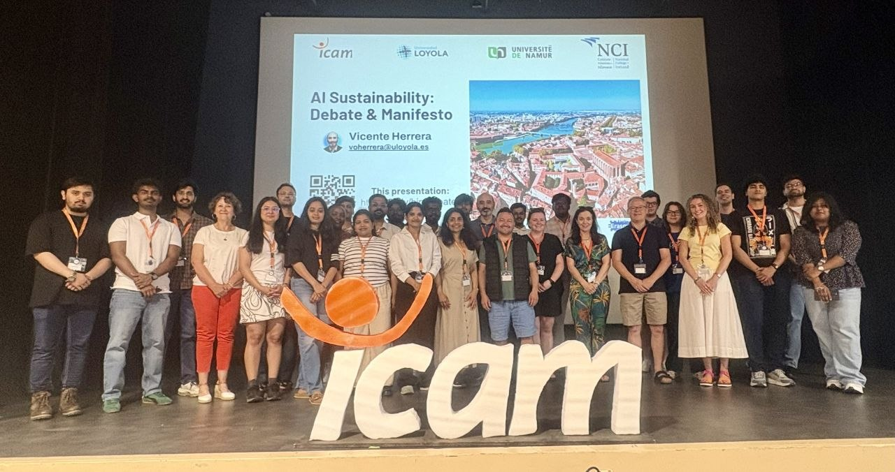

# Sustainable AI Manifesto for EU

## Toulouse 2026

* Link to the Manifesto: [dhwanikariya.github.io/manifesto-sustainable-ai](https://dhwanikariya.github.io/manifesto-sustainable-ai)
* Erasmus Blended International Programme 2026
* Universities: [Loyola](https://uloyola.es), [NCI](https://www.ncirl.ie), [ICAM](https://icam.fr), [Namur](https://namur.be)
* More information: [icam.fr/news/international-en/icam-toulouse-a-european-testing-ground-for-sustainable-ai](https://en.icam.fr/news/international-en/icam-toulouse-a-european-testing-ground-for-sustainable-ai)

